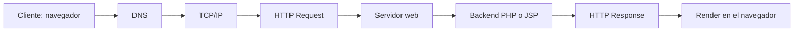

# GuiaPracticaGrupalSemana09

# Sistema de Registro de Contacto para Consultas Médicas
Hospital Nacional Ramiro Prialé Prialé
Independencia 266, Huancayo 12006, distrito de El Tambo, provincia de Huancayo, departamento de Junín, Perú.

Universidad Nacional del Centro del Perú
Facultad de Ingeniería de Sistemas
Desarrollo de Aplicaciones Web - IX Semestre

## Integrantes
| Integrante | Responsabilidad |
|---|---|
| Edgar Robert Gago Uribe | Aplicación PHP, ciclo HTTP y README |
| Huamanlazo Pariona Steven Luis | Aplicación JSP y matriz comparativa |

## Estructura
```
Repositorio
├── README.md
├── docs
│   ├── capturas
│   ├── ciclo-http.md
│   └── matriz-comparativa.md
├── php-app
│   ├── css/estilos.css
│   ├── index.html
│   ├── procesar.php
│   └── error.php
└── jsp-app
    ├── css/estilos.css
    ├── index.jsp
    ├── procesar.jsp
    ├── error.jsp
    └── WEB-INF
        ├── web.xml
        └── lib
```

## Requisitos
| Componente | Versión |
|---|---|
| JDK | 17 o superior, con `JAVA_HOME` definido |
| Apache Tomcat | 10.1.x |
| XAMPP | Apache 2.4 con PHP 8.2 o superior |
| Extensiones PHP | session, filter, mbstring |
| Navegador | Chrome, Edge o Firefox actual |

Las librerías JSTL para Jakarta se encuentran en `jsp-app/WEB-INF/lib`.

## Despliegue
Desde la raíz del repositorio, en CMD, crear enlaces hacia las carpetas que sirve cada servidor
```cmd
mklink /J C:\xampp\htdocs\php-app "RUTA\php-app"
mklink /J C:\apache-tomcat-10.1.61\webapps\jsp-app "RUTA\jsp-app"
```

1. Abrir el panel de XAMPP e iniciar Apache.
2. Ejecutar `C:\apache-tomcat-10.1.61\bin\startup.bat`.
3. Abrir la aplicación correspondiente.

| Aplicación | URL |
|---|---|
| PHP | http://localhost/php-app/ |
| JSP | http://localhost:8080/jsp-app/ |

Logs:

- Apache: `C:\xampp\apache\logs`
- Tomcat: `C:\apache-tomcat-10.1.61\logs`

## Ciclo HTTP


El detalle de cada etapa se encuentra en [docs/ciclo-http.md](docs/ciclo-http.md).

## Seguridad agregada
| Medida | PHP | JSP |
|---|---|---|
| Validación del método POST | `$_SERVER['REQUEST_METHOD']` con respuesta 405 | `request.getMethod()` con respuesta 405 |
| Validación de datos | `filter_input`, `filter_var` y expresión regular | Validación de `request.getParameter()` |
| Prevención de XSS | `htmlspecialchars` al mostrar | `<c:out>` al mostrar |
| Manejo de errores | 405, 422 y 500 con `error.php` | 405, 422 y 500 con `error.jsp` |
| Sesión | `session_start` con cookie `HttpOnly` y `SameSite=Lax` | `request.getSession()` |

## Matriz comparativa PHP vs JSP
Ver [docs/matriz-comparativa.md](docs/matriz-comparativa.md).

## Capturas
Las capturas de pantalla, logs y respuestas HTTP están en la carpeta [docs/capturas](docs/capturas).


