# GuiaPracticaGrupalSemana09

# Sistema de Registro de Contacto para Consultas Médicas
Hospital Nacional Ramiro Prialé Prialé
Independencia 266, Huancayo 12006, distrito de El Tambo, provincia de Huancayo, departamento de Junín, Perú.

Universidad Nacional del Centro del Perú
Facultad de Ingeniería de Sistemas
Desarrollo de Aplicaciones Web - IX Semestre

## Integrantes
| Integrante | Responsabilidad |
|---|---|
| Edgar Robert Gago Uribe | Aplicación PHP, ciclo HTTP y README |
| Huamanlazo Pariona Steven Luis | Aplicación JSP y matriz comparativa |

## Estructura
```
Repositorio
├── README.md
├── docs
│   ├── capturas
│   ├── ciclo-http.md
│   └── matriz-comparativa.md
├── php-app
│   ├── css/estilos.css
│   ├── index.html
│   ├── procesar.php
│   └── error.php
└── jsp-app
    ├── css/estilos.css
    ├── index.jsp
    ├── procesar.jsp
    ├── error.jsp
    └── WEB-INF
        ├── web.xml
        └── lib
```

## Requisitos
| Componente | Versión |
|---|---|
| JDK | 17 o superior, con `JAVA_HOME` definido |
| Apache Tomcat | 10.1.x |
| XAMPP | Apache 2.4 con PHP 8.2 o superior |
| Extensiones PHP | session, filter, mbstring |
| Navegador | Chrome, Edge o Firefox actual |

Las librerías JSTL para Jakarta se encuentran en `jsp-app/WEB-INF/lib`.

## Despliegue
Desde la raíz del repositorio, en CMD, crear enlaces hacia las carpetas que sirve cada servidor
```cmd
mklink /J C:\xampp\htdocs\php-app "RUTA\php-app"
mklink /J C:\apache-tomcat-10.1.61\webapps\jsp-app "RUTA\jsp-app"
```

1. Abrir el panel de XAMPP e iniciar Apache.
2. Ejecutar `C:\apache-tomcat-10.1.61\bin\startup.bat`.
3. Abrir la aplicación correspondiente.

| Aplicación | URL |
|---|---|
| PHP | http://localhost/php-app/ |
| JSP | http://localhost:8080/jsp-app/ |

Logs:

- Apache: `C:\xampp\apache\logs`
- Tomcat: `C:\apache-tomcat-10.1.61\logs`

## Ciclo HTTP
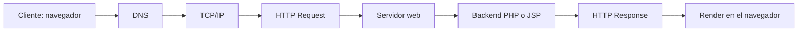

El detalle de cada etapa se encuentra en [docs/ciclo-http.md](docs/ciclo-http.md).

## Seguridad agregada
| Medida | PHP | JSP |
|---|---|---|
| Validación del método POST | `$_SERVER['REQUEST_METHOD']` con respuesta 405 | `request.getMethod()` con respuesta 405 |
| Validación de datos | `filter_input`, `filter_var` y expresión regular | Validación de `request.getParameter()` |
| Prevención de XSS | `htmlspecialchars` al mostrar | `<c:out>` al mostrar |
| Manejo de errores | 405, 422 y 500 con `error.php` | 405, 422 y 500 con `error.jsp` |
| Sesión | `session_start` con cookie `HttpOnly` y `SameSite=Lax` | Objeto `session` con cookie `JSESSIONID` `HttpOnly` |

## Matriz comparativa PHP vs JSP

Comparación técnica de las dos implementaciones del Sistema de Registro de Contacto.

| Criterio | PHP (XAMPP, Apache) | JSP (Tomcat 10.1) |
|---|---|---|
| Ciclo de vida | Cada petición ejecuta el script desde cero (modelo share-nothing). Apache entrega el archivo al intérprete PHP, que lo ejecuta, responde y libera variables y memoria. Con OPcache el bytecode se reutiliza entre peticiones. | En la primera petición Jasper traduce el `.jsp` a un servlet Java y lo compila. El contenedor crea una sola instancia que atiende las peticiones en hilos distintos, con las fases `jspInit`, `_jspService` y `jspDestroy`. |
| Rendimiento | Arranque rápido por petición y buen desempeño con OPcache. Escala añadiendo procesos o servidores. | La primera petición es más lenta por la compilación. Luego el JIT de la JVM optimiza el código, con buen rendimiento sostenido bajo concurrencia y mayor consumo base de memoria. |
| Despliegue | Se copian los archivos a `htdocs`. No hay compilación ni empaquetado. Apache escucha en el puerto 80 y se configura con `httpd.conf` y `php.ini`. | Se publica una carpeta o un WAR en `webapps`, con `WEB-INF/web.xml` y las librerías en `WEB-INF/lib`. Requiere JDK y escucha en el puerto 8080. Los cambios en un JSP se recompilan solos, y los de `web.xml` requieren recarga. |
| Gestión de estado | `$_SESSION` tras `session_start()`. El identificador viaja en la cookie `PHPSESSID` y los datos se guardan por defecto en archivos del servidor (`session.save_path`). | Objeto implícito `session` (`HttpSession`). El identificador viaja en la cookie `JSESSIONID` y los datos viven en la memoria de la JVM, con ámbitos `request`, `session` y `application` compartidos entre hilos. |
| Plantillas y sintaxis | Etiquetas `<?php ?>` y `<?= ?>` mezcladas con HTML, con funciones nativas del lenguaje. | Scriptlets `<% %>`, expresiones EL `${}` y etiquetas JSTL como `<c:forEach>` y `<c:out>`, que separan mejor la vista de la lógica. |
| Seguridad básica | `htmlspecialchars` para escapar salida, `filter_input` y `filter_var` para validar entrada. | `<c:out>` escapa por defecto, y la validación se hace con expresiones regulares y comprobaciones en Java. Ambos requieren validar siempre en el servidor. |
| Madurez del ecosistema | Lenguaje de 1995 con una comunidad web muy grande. Usa Composer y Packagist, con frameworks como Laravel y Symfony y plataformas como WordPress. | Tecnología de 1999 integrada en Jakarta EE. Usa Maven y Gradle, con frameworks como Spring. Es habitual en sistemas empresariales y heredados, y hoy suele convivir con otras capas de vista. |

### Aplicado en este proyecto

| Elemento | php-app | jsp-app |
|---|---|---|
| Archivos | `index.html`, `procesar.php`, `error.php` | `index.jsp`, `procesar.jsp`, `error.jsp`, `WEB-INF/web.xml` |
| URL local | `http://localhost/php-app/` | `http://localhost:8080/jsp-app/` |
| Validación del método | `$_SERVER['REQUEST_METHOD']` con respuesta 405 y cabecera `Allow: POST` | `request.getMethod()` con `sendError(405)` y cabecera `Allow: POST` |
| Lectura de datos | `filter_input(INPUT_POST, ...)` | `request.getParameter(...)` |
| Validación | Longitud, expresión regular `\p{L}` y `FILTER_VALIDATE_EMAIL` | Longitud, expresión regular `\p{L}` y expresión regular de correo |
| Prevención de XSS | `htmlspecialchars` mediante la función `e()` | `<c:out>` |
| Sesión | `$_SESSION['registros']` con cookie `HttpOnly` y `SameSite=Lax` | `session.getAttribute("registros")` con cookie `JSESSIONID` `HttpOnly` |
| Iteración de la tabla | `foreach` | `<c:forEach>` con `varStatus` |
| Errores 4xx y 5xx | Función `fallar()` que carga `error.php` | `sendError` y `<error-page>` en `web.xml` que apuntan a `error.jsp` |

## Capturas
Las capturas de pantalla, logs y respuestas HTTP están en la carpeta [docs/capturas](docs/capturas).


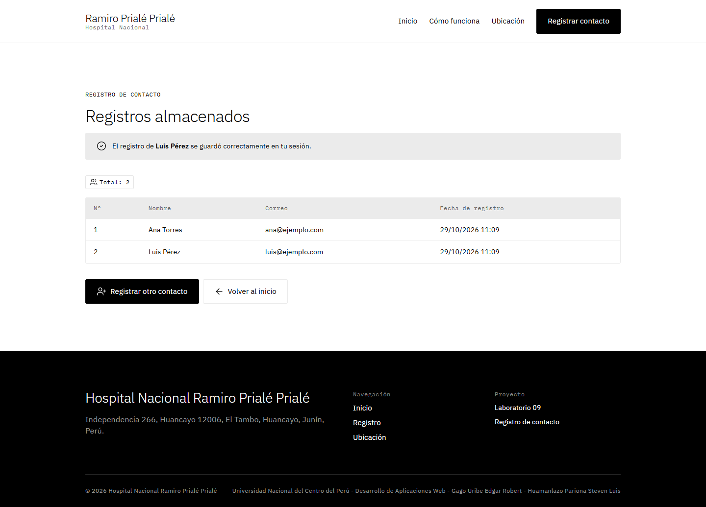


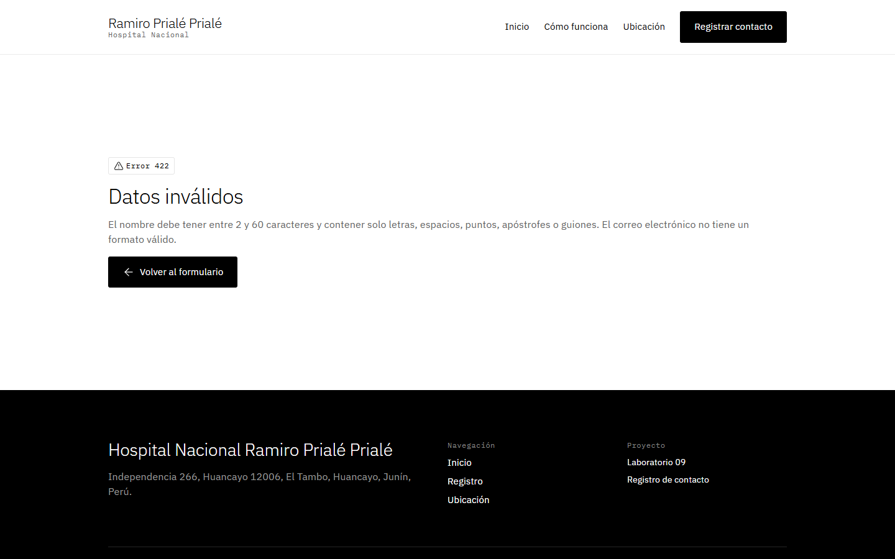

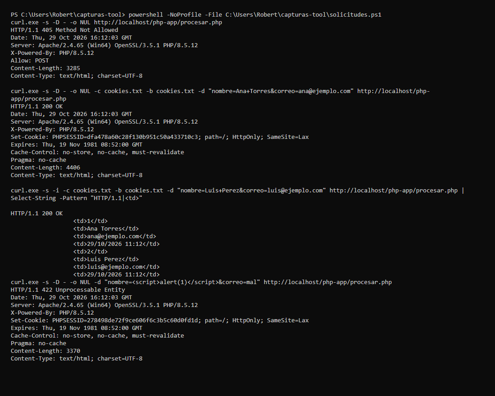

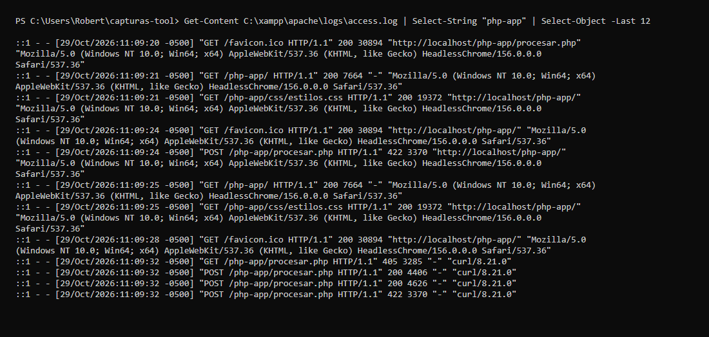

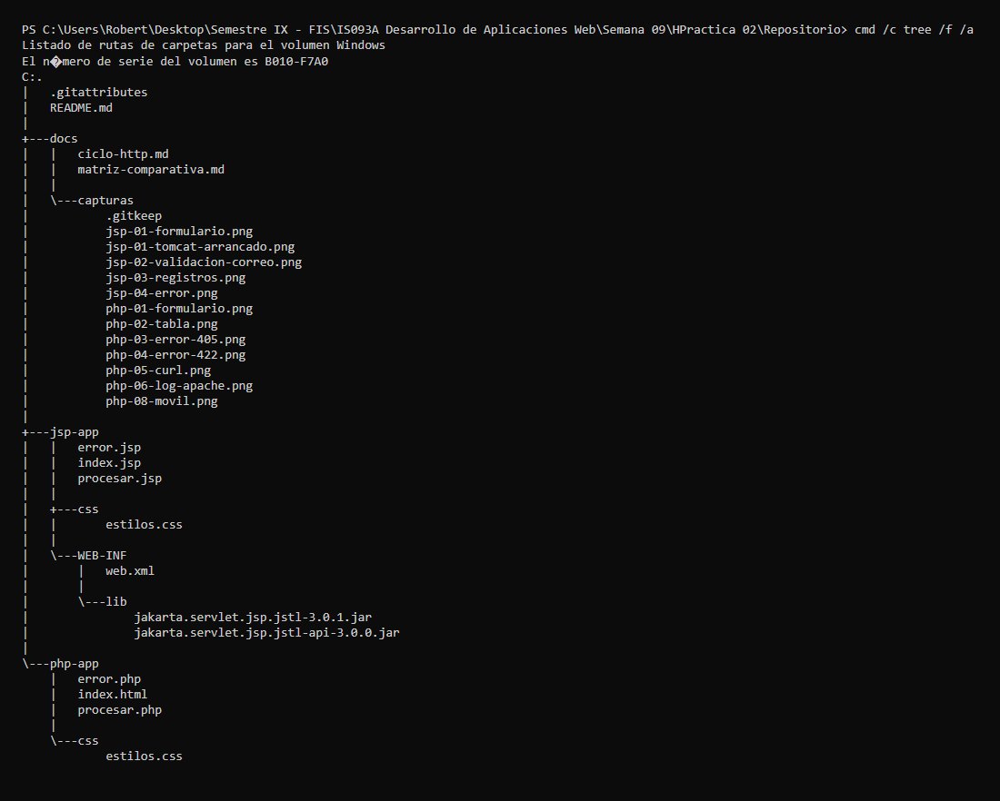


## Capturas JSP
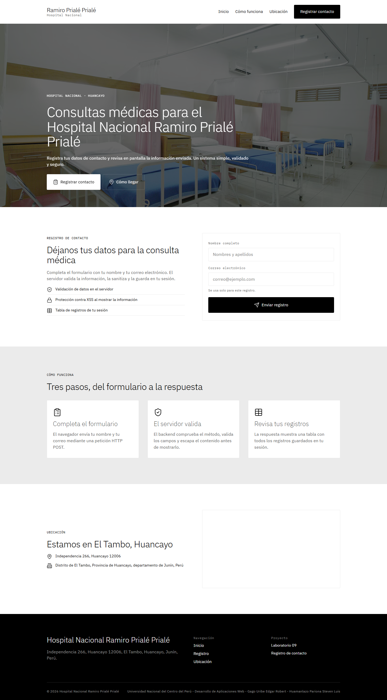


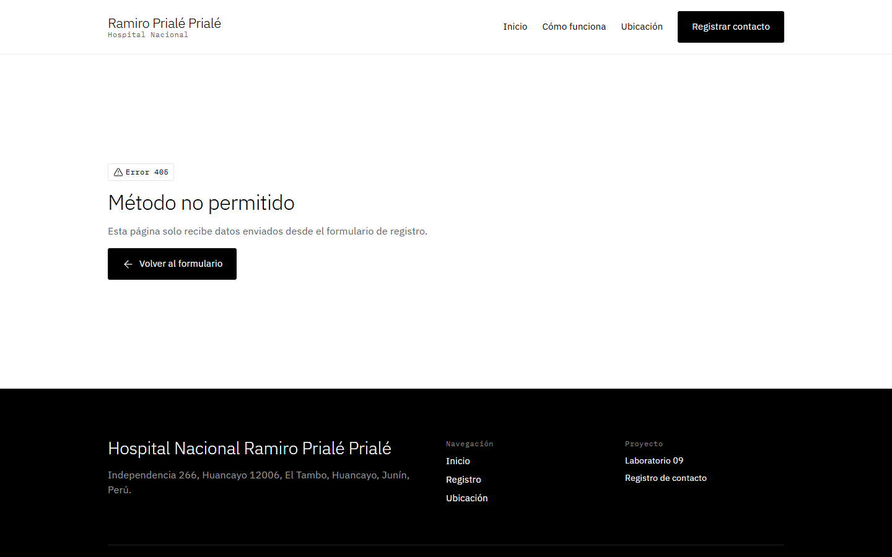


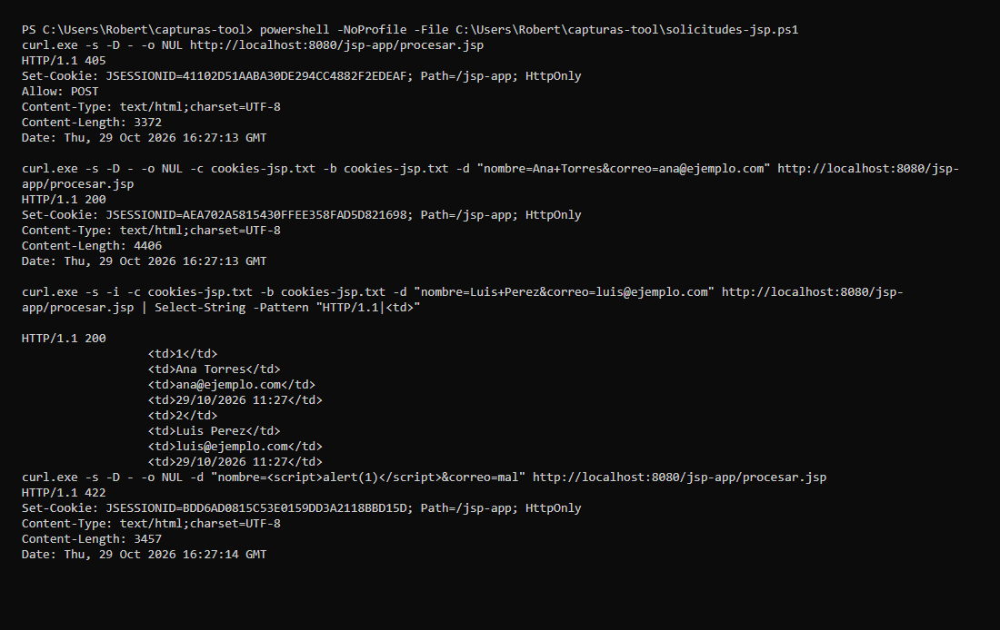

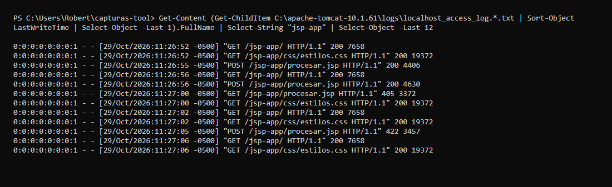

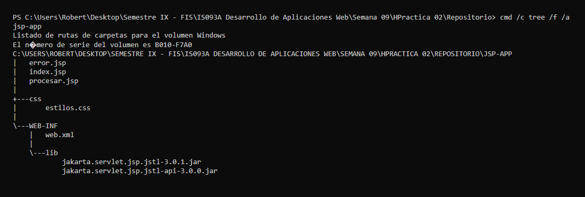


