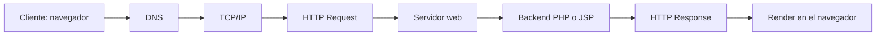

# Integrantes
- Gago Uribe Edgar Robert
- Huamanlazo Pariona Steven Luis

# Ciclo HTTP del Sistema de Registro de Contacto
Recorrido de una petición desde el navegador hasta el render para las 2 aplicaciones.

## Diagrama de flujo


## Etapas
| N° | Etapa | Qué ocurre | En este proyecto |
|---|---|---|---|
| 1 | Cliente | El usuario completa el formulario y pulsa Enviar | `index.html` o `index.jsp` |
| 2 | DNS | El nombre del host se traduce a una dirección IP | `localhost` se resuelve a `127.0.0.1` mediante el archivo hosts |
| 3 | TCP/IP | Se abre una conexión TCP con el servidor (three-way handshake) | Puerto 80 con Apache y puerto 8080 con Tomcat |
| 4 | HTTP Request | El navegador envía método, ruta, cabeceras y cuerpo | `POST /php-app/procesar.php` o `POST /jsp-app/procesar.jsp` |
| 5 | Servidor web | Recibe la petición y la entrega al intérprete del backend | Apache con PHP y Tomcat con Jasper |
| 6 | Backend | Valida el método, valida y sanitiza datos, usa la sesión | `$_POST` y `$_SESSION` en PHP, `request` y `session` en JSP |
| 7 | HTTP Response | El servidor devuelve código de estado, cabeceras y HTML | `200`, `405`, `422` o `500` |
| 8 | Render | El navegador interpreta el HTML, descarga el CSS y dibuja la página | Tabla de registros o página de error |

## Petición de ejemplo
```
POST /php-app/procesar.php HTTP/1.1
Host: localhost
Content-Type: application/x-www-form-urlencoded
Content-Length: 42
Cookie: PHPSESSID=abc123

nombre=Ana+Torres&correo=ana%40ejemplo.com
```

## Respuesta de ejemplo
```
HTTP/1.1 200 OK
Content-Type: text/html; charset=UTF-8
Set-Cookie: PHPSESSID=abc123; path=/; HttpOnly; SameSite=Lax

<!DOCTYPE html>
<html lang="es">
...
```

## Códigos de estado manejados
| Código | Cuándo se produce | Respuesta |
|---|---|---|
| 200 | Datos válidos y registro guardado | Tabla de registros |
| 405 | La página se abre con un método distinto de POST | Página de error con la cabecera `Allow: POST` |
| 422 | El nombre o el correo no superan la validación | Página de error con el detalle |
| 500 | Falla al iniciar la sesión | Página de error del servidor |

## Rutas de acceso
| Aplicación | URL | Servidor |
|---|---|---|
| PHP | `http://localhost/php-app/` | Apache (XAMPP), puerto 80 |
| JSP | `http://localhost:8080/jsp-app/` | Tomcat 10.1, puerto 8080 |
